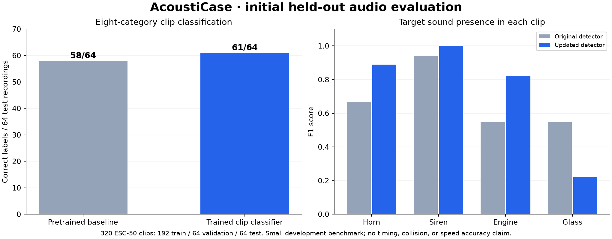

# AcoustiCase ML development record

## What runs in the app

Pipeline 0.2.0 groups related frozen Google YAMNet predictions, uses separate onset/continuation thresholds, joins brief prediction gaps, and suppresses broad vehicle labels when a specific event covers the interval. Twelve sound groups are supported. Different simultaneous groups remain visible. Group scores are maxima, not sums or calibrated probabilities.

The original filter contained two nonexistent label names. The replacement uses YAMNet's actual `Smash, crash` and `Accelerating, revving, vroom` labels. Impact suggestions do not establish a collision.

Inference uses blocks of 64 patches with right context, limiting activation memory for longer uploads. A live comparison against whole-waveform inference passed for 135 patches across a 65-second recording and five short-clip boundary cases. Silence produced no sound events. The optional `assets.sound_scores_url` contains grouped score history; existing events and findings remain compatible.

## Separately trained experimental classifier

A multinomial logistic-regression head was trained on frozen YAMNet features. Each recording becomes a 2,048-value vector: mean and standard deviation of its 1,024-dimensional frame embeddings. StandardScaler was fitted on training recordings only. Four regularization settings were compared on validation macro F1; C=0.01 was selected. The portable NPZ contains numeric arrays and class names, with no pickle loading.

The model is included in `backend/evaluation/artifacts/experimental-clip-head.npz` and can be tried with `scripts/predict_clip.py`. It classifies a short recording among eight known categories. It is **not the API's event detector**: whole-clip training labels do not establish event boundaries or behavior on unknown sounds and mixtures. The app uses YAMNet's broader label set for event suggestions.

## Data and split

The subset contains 320 five-second [ESC-50](https://github.com/karolpiczak/ESC-50) recordings: car horn, siren, engine, glass breaking, rain, wind, footsteps, and dog. There are 40 recordings per category, from 271 original source recordings in total.

| Partition | Official folds | Recordings | Purpose |
| --- | --- | ---: | --- |
| Training | 1–3 | 192 | Fit scaler and linear classifier |
| Validation | 4 | 64 | Select regularization and four detector thresholds |
| Test | 5 | 64 | Evaluate selected configurations |

Scripts reject overlapping folds, duplicate clips, and original source IDs crossing partitions. The upstream revision, source URLs, audio hashes, split assignments, feature provenance, model hash, and test predictions are recorded under `backend/evaluation/`. Test examples were not used for parameter selection. Test results have now been inspected; later changes evaluated on this set are development comparisons, not a fresh independent test.

## Observed results

One fixed split was evaluated locally on 2026-11-21. The clip-classification baseline takes the largest mean grouped YAMNet score among the same eight categories.

| Clip classifier | Correct / 64 | Accuracy | Macro F1 |
| --- | ---: | ---: | ---: |
| Pretrained grouped baseline | 58 | 90.6% | 0.884 |
| Trained linear head | 61 | 95.3% | 0.953 |

This is a three-recording improvement on a small, restricted task. It is not an estimate of general road-scene accuracy or a statistically established improvement.

The event detector was evaluated separately: did a target have any candidate interval in the clip? Dominant clip labels are weak labels; unannotated secondary sounds can affect false-positive counts. Event timing was not scored.

| Target | Original F1 | Updated F1 | Updated correct detections / 8 | Updated false positives / 56 other clips |
| --- | ---: | ---: | ---: | ---: |
| Horn | 0.667 | 0.889 | 8 | 2 |
| Siren | 0.941 | 1.000 | 8 | 0 |
| Engine | 0.545 | 0.824 | 7 | 2 |
| Glass breaking | 0.545 | 0.222 | 1 | 0 |
| Macro average | 0.675 | 0.734 | — | — |

Correct target detections increased from 18 to 24 out of 32 labeled positives; false positives increased from 1 to 4 across 224 negative class/clip decisions. The tuned glass threshold generalized poorly. It is retained as selected on validation, with its weak recall documented; it was not adjusted using test results. Siren's perfect result covers only eight positive clips.

Live thresholds are horn=0.15, siren=0.75, engine=0.15, glass=0.75. Selection maximizes validation F0.5 on a fixed grid, preferring precision and then a higher threshold on ties. Other groups retain heuristic thresholds with no detector benchmark claim. `backend/evaluation/initial-detection-profile.json` freezes the untuned comparison.



## Demo and limits

`backend/examples/constructed-sound-scene.wav` is a 25-second collage: engine, horn, glass, and siren excerpts separated by silence. Training clips were curated for clear recognition. The adjacent JSON records source excerpts and selection, with separate source attribution. It is not evaluation data or a recording of an actual incident. Upload with `is_simulated=true` and leave Doppler assumptions false. Excerpt spans are not manually annotated sound onsets.

No real-vehicle speed accuracy, collision detection accuracy, tire-squeal evaluation, causal reconstruction, calibrated uncertainty, or event-boundary accuracy has been established. The trained head forces every input into one of eight classes. YAMNet pretraining overlap with this public dataset has not been audited. Real phone recordings, mixtures, wind, echoes, and changing engine pitch still require independent testing.

## Reproduce

From `backend/`, with the project environment activated:

```bash
pip install -e '.[ml,test]'
python scripts/download_yamnet.py
python scripts/download_eval.py
python scripts/ml_benchmark.py extract
python scripts/ml_benchmark.py run
python scripts/verify_ml_runtime.py
python -m pytest -q
```

The audio subset is roughly 140 MB. Raw audio, features, and experiment outputs stay in ignored `data/`; checked-in results and weights are snapshots of the documented run. Rerunning does not silently overwrite the live profile or checked-in results. `scripts/build_sound_demo.py` regenerates the collage; `scripts/plot_ml_results.py` regenerates the figure.

Try the saved head after installing classifier dependencies and downloading YAMNet:

```bash
python scripts/predict_clip.py path/to/five-second-recording.wav
```

It accepts at most six seconds and prints ranked, uncalibrated scores. There is no unknown-class rejection mechanism; the highest score is not verified evidence.

## Sources and attribution

- [TensorFlow YAMNet transfer learning](https://www.tensorflow.org/tutorials/audio/transfer_learning_audio) describes frozen embeddings for a smaller classifier. This implementation uses a linear model and clip-level pooling.
- [ESC-50, Karol J. Piczak](https://github.com/karolpiczak/ESC-50), revision `33c8ce9eb2cf0b1c2f8bcf322eb349b6be34dbb6`. Dataset license and individual credits are preserved in `backend/evaluation/ESC50-LICENSE`; collage credits also appear in `backend/examples/CONSTRUCTED-SCENE-ATTRIBUTION.md`.
- This subset is used for a noncommercial research prototype under ESC-50's CC BY-NC terms. Preserve these notices with the supplied demo and research artifacts; this is not a commercial-use data clearance.
- Google YAMNet source and class-map files retain their upstream Apache 2.0 license. Weights are downloaded separately with a pinned SHA-256.
